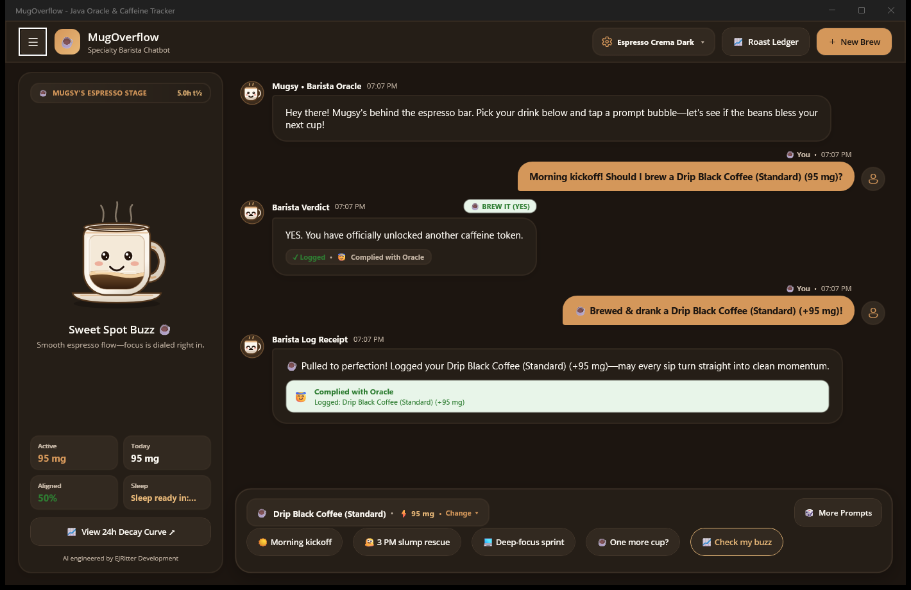
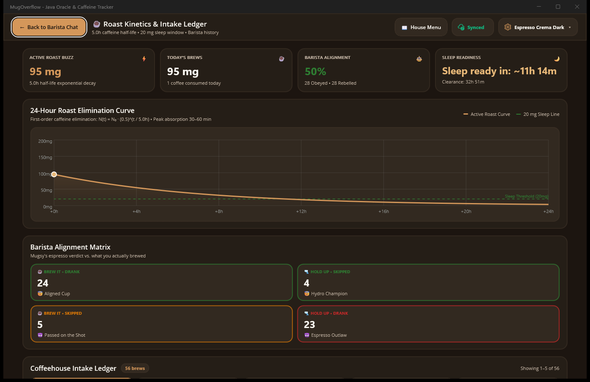

# ☕ MugOverflow

[](https://dotnet.microsoft.com/download/dotnet/11.0)
[](https://learn.microsoft.com/en-us/dotnet/maui/)
[](https://learn.microsoft.com/en-us/dotnet/maui/supported-platforms)
[](./tests/MugOverflowProject.Tests)
[](./LICENSE)

**MugOverflow** is a cross-platform coffeehouse barista oracle chatbot and pharmacokinetic caffeine tracker built on **.NET 11** and **.NET MAUI**. Ask **Mugsy**—a live, 60fps animated coffee mug mascot—whether to pour your next cup with zero keyboard typing required, then track real-time caffeine absorption, active milligrams, barista alignment, and sleep readiness across a **24-hour elimination decay curve**.

---

## ✨ Visual Showcase & Features

### ☕ Mugsy Barista Chatbot & Hero Espresso Stage



*Captured on Windows (`.NET 11`) using the default **Espresso Crema Dark** roast theme.*

- **60fps Animated Coffee Mascot (`CoffeeMascotView`)**: Rendered directly on a custom `Microsoft.Maui.Graphics` `IDrawable` canvas (`CoffeeMascotDrawable`), Mugsy reacts continuously across **7 dynamic moods** (`Sleepy`, `Happy`, `Wired`, `Brewing`, `CelebratingYes`, `SternNo`, `SplashSkip`) with animated liquid fill levels, crema foam, rising steam curls, and expressive eyes synced to your live caffeine state.
- **100% Tap-Chip Conversational Chat**: Consult Mugsy effortlessly from the floating composer dock—no typing needed:
  - **House Coffee & Caffeine Menu**: Pick from 10 calibrated coffeehouse drinks (`Drip Black Coffee (Standard)` 95 mg, `Single Shot Espresso` 63 mg, `Double Shot Espresso (Doppio)` 126 mg, `Cold Brew Coffee` 155 mg, `Nitro Cold Brew` 215 mg, `Caffè Latte` 75 mg, `Cappuccino` 75 mg, `Pour Over Coffee (Light/Medium)` 110 mg, `Caffè Americano` 126 mg, `Decaf Brewed Coffee` 4 mg).
  - **Rotating Scenario Prompt Chips**: Choose from 10 rotating barista prompts (`☀️ Morning kickoff`, `🫠 3 PM slump rescue`, `💻 Deep-focus sprint`, `☕ One more cup?`, `🥐 Post-lunch coma`, `🌧️ Cozy café vibe`, `🔍 Code-review survival`, `🌙 Late-shift deploy`, `✨ Barista's blessing`, `🎙️ Pre-standup boost`) with a **🎲 More Prompts** shuffler plus a persistent **📈 Check my buzz** chip.
  - **Stochastic Barista Verdict & Log Receipt**: 100 randomized oracle verdicts (`50` YES / `50` NO) followed by interactive quick-reply pills (`☕ Brewed & drank <Drink>!`, `🫗 Skipped this round`, `🔄 Swap drink`) and 20 4-quadrant Barista Log Receipt reactions tracking whether you **Complied** or **Rebelled**.
- **Slide-Over Coffeehouse Drawer (`Mugsy's Roastery`)**: Open from the top-left `☰` button to start a **＋ New Brew Chat**, browse **📖 House Coffee Menu**, jump to **📈 Roast Kinetics & Ledger**, switch or delete **PAST BREW SESSIONS**, configure **Cloud Sync**, or change your **Roast Theme**.

---

### 📈 Roast Kinetics & Intake Ledger



*Sidebar-free responsive Bento telemetry stage with 24-hour exponential caffeine elimination curve and outcome matrix.*

- **Pharmacokinetic Decay Engine (`CaffeineMetabolismService`)**: Models active circulating caffeine with first-order exponential elimination over a **5.0-hour biological half-life**:
  $$N(t) = N_0 \cdot (0.5)^{t / 5.0\text{h}}$$
- **24-Hour Roast Elimination Curve**: Interactive `GraphicsView` plot (`CaffeineMetabolismDrawable`) displaying active caffeine decay over the next 24 hours against the **20 mg Sleep Threshold** reference line (`1.0 mg` full clearance estimate).
- **Barista Alignment Matrix**: 2×2 outcome scorecard tracking your compliance across four quadrants:
  - `☕ BREW IT • DRANK` *(Aligned Cup)*
  - `🫗 HOLD UP • SKIPPED` *(Hydro Champion)*
  - `☕ BREW IT • SKIPPED` *(Passed on the Shot)*
  - `🫗 HOLD UP • DRANK` *(Espresso Outlaw)*
- **Searchable, Filterable & Paginated Intake Ledger**: Browse full brew history with 5 filter pills (`All`, `Drank`, `Skipped`, `Complied`, `Rebelled`), live keyword search, `5 / 10 / 20` row pagination, and inline log editing or deletion (`EditLogPopup`).

---

## 🎨 5 Coffeehouse Drink Flavor Theme Pairs (10 Palettes)

Switch themes instantaneously at runtime without restarting the app via the **Roast Theme** pill (`ThemeSelectorPopup`), powered by `ThemeManager` with 24 semantic `DynamicResource` color tokens per palette and persisted in `Preferences`:

| Coffeehouse Drink Flavor | Light Roast Palette | Dark Roast Palette |
| :--- | :--- | :--- |
| ☕ **Espresso & Oat Latte** *(House Signature)* | **Steamed Oat Latte** | **Espresso Crema Dark** *(Default)* |
| 🍫 **Caramel Mocha** *(Velvet Cacao & Amber Drizzle)* | **Caramel Macchiato** | **Mocha Velvet Dark** |
| 🍵 **Ceremonial Matcha** *(Whisked Botanical & Shot)* | **Iced Matcha Latte** | **Dirty Matcha Dark** |
| 🪻 **Lavender Cold Brew** *(Wildflower Honey & Steep)* | **Honey Lavender Latte** | **Midnight Cold Brew** |
| 🌿 **Mint Cortado** *(Garden Mint & Double Ristretto)* | **Sweet Mint Cortado** | **Dark Mint Espresso** |

---

## ☁️ Local-First SQLite & Bring Your Own Storage (BYOS)

MugOverflow is offline-first and gives you complete ownership of your caffeine logs and chat sessions:

- **High-Concurrency Local SQLite**: Powered by **Dapper** (`2.1.89`), **Microsoft.Data.Sqlite** (`11.0.0`), and **SQLitePCLRaw.bundle_e_sqlite3** (`3.0.5`) backed by `MugOverflow.db3` in `FileSystem.AppDataDirectory` with Write-Ahead Logging (`PRAGMA journal_mode = WAL;`), `synchronous = NORMAL`, and a `5000ms` busy timeout (`DapperDatabaseService`).
- **BYOS Storage & 3-Way Migration (`StorageSelectionPopup`)**: Open the **Cloud Sync** selector from the **Slide-Over Drawer (`☰`)** on `MainPage` or the **top navigation bar** on `MetabolismPage` to switch and cleanly migrate data across:
  1. **Local SQLite & JSON Export**: Zero-config local backup at `<AppDataDirectory>/MugOverflow-Caffeine-consumption/caffeine_consumption.json`.
  2. **Google Drive Cloud (`appDataFolder`)**: Zero-backend OAuth 2.0 PKCE + Google Drive v3 REST API storing `caffeine_consumption.json` privately in your hidden Drive App Data folder (`https://www.googleapis.com/auth/drive.appdata`).
  3. **Microsoft OneDrive (`AppFolder`)**: MSAL.NET (`Microsoft.Identity.Client`) + Microsoft Graph v1.0 storing `caffeine_consumption.json` in `special/approot`.

### Setting Up Your Own Google Drive OAuth Client

To connect your own Google Cloud OAuth credentials for `GoogleDriveStorageProvider`:

1. Open [Google Cloud Console](https://console.cloud.google.com/), create or select a project, and enable the **Google Drive API**.
2. Under **APIs & Services -> OAuth consent screen**, add your Google account as a **Test User** and include the restricted scope:
   ```
   https://www.googleapis.com/auth/drive.appdata
   ```
3. Under **Credentials -> Create Credentials -> OAuth client ID**:
   - **Windows Desktop**: Choose **Desktop app** (the app handles OAuth redirects automatically via a loopback `HttpListener`).
   - **Android**: Choose **Android**, enter package name **`ejritterdevelopment.mugflow.app`** (`Platforms/Android/AndroidManifest.xml`), and supply your signing keystore SHA-1 (`WebAuthenticationCallbackActivity` listens on `mugoverflow://oauth2redirect`).
4. Configure your Client ID(s) / Secret via a gitignored partial override `Services/Storage/GoogleDriveConfig.Local.cs` (implementing `partial void ApplyLocalSecrets()`), directly in `Services/Storage/GoogleDriveConfig.cs`, or at runtime via `ISecureStorageService` (`google_drive_custom_windows_client_id`, `google_drive_custom_windows_client_secret`, `google_drive_custom_android_client_id`, `google_drive_custom_android_client_secret`).
5. Rebuild, open the **Cloud Sync** popup (via the `☰` Slide-Over Drawer or the `MetabolismPage` top bar), and click **Connect** on **Google Drive Cloud**.

---

## 🏗️ Architecture & Tech Stack

| Layer | Technology | Version / Implementation |
| :--- | :--- | :--- |
| **Framework** | **.NET 11 / .NET MAUI** | `net11.0-windows10.0.19041.0`, `net11.0-android`, `net11.0-ios`, `net11.0-maccatalyst` (`global.json` pinned to `11.0.100`) |
| **Language & Solution** | **C# 15 (`latest`) & `.slnx`** | Modern XML solution (`MugOverflowProject.slnx`) with `CommunityToolkit.Mvvm` partial properties |
| **UI & Canvas** | **MAUI XAML, Toolkit & Graphics** | `Microsoft.Maui.Controls 11.0.10`, `CommunityToolkit.Maui 17.0.0`, `FluentIcons.Maui 2.1.345`, 60fps `IDrawable` controls |
| **Local Database** | **SQLite + Dapper** | `Dapper 2.1.89`, `Microsoft.Data.Sqlite 11.0.0`, `SQLitePCLRaw.bundle_e_sqlite3 3.0.5` (`WAL` mode) |
| **Cloud & Auth** | **Google Drive v3 & MSAL.NET** | OAuth 2.0 PKCE (`appDataFolder`) & `Microsoft.Identity.Client 4.92.0` (`AppFolder`) |
| **Diagnostics** | **Serilog & DevFlow** | `Serilog 4.4.0`, `WinUiCrashPolicy`, `Microsoft.Maui.DevFlow.Agent` (`#if DEBUG`) |
| **Testing** | **xUnit (`net11.0`)** | `xunit 2.9.3` headless test suite with custom service fixtures & fakes (**640 automated tests passing**) |

---

## 🚀 Getting Started & Building

### Prerequisites

- [.NET 11 SDK (`11.0.100`)](https://dotnet.microsoft.com/download/dotnet/11.0) with `.NET MAUI` workload installed (`dotnet workload install maui`)
- Visual Studio 2026 (or VS Code with .NET MAUI extension) with Windows App SDK & Android SDK components (for target builds)

### Clone & Run Tests

```powershell
git clone https://github.com/ejritter/MugOverflow.git
cd MugOverflow

# Run the headless .NET 11 test suite (640 passing tests)
dotnet test tests/MugOverflowProject.Tests/MugOverflowProject.Tests.csproj
```

### Run on Windows & Android (Debug)

```powershell
# Launch Windows Desktop (Debug)
dotnet run -f net11.0-windows10.0.19041.0

# Build and run on connected Android Emulator / Device (Debug)
dotnet build -t:Run -f net11.0-android
```

### Publish Windows Desktop Release

```powershell
dotnet publish MugOverflowProject.csproj -f net11.0-windows10.0.19041.0 -c Release -o "$env:USERPROFILE\Desktop\MugOverflowApp"
```

---

## 📄 License

This project is licensed under the **MIT License** — see [LICENSE](LICENSE) for full details.
