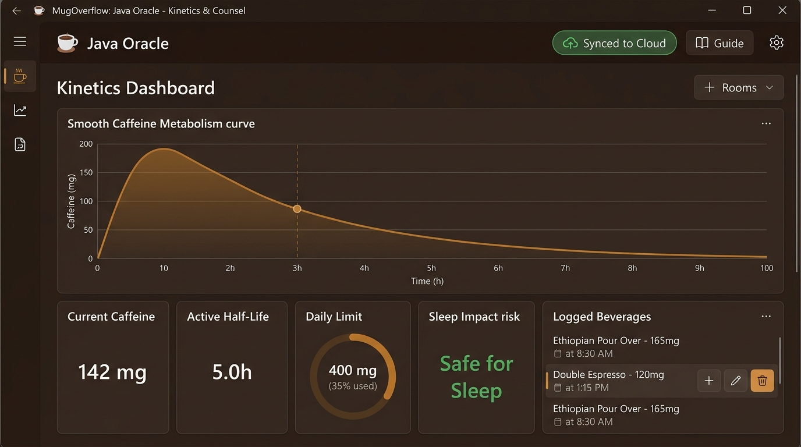
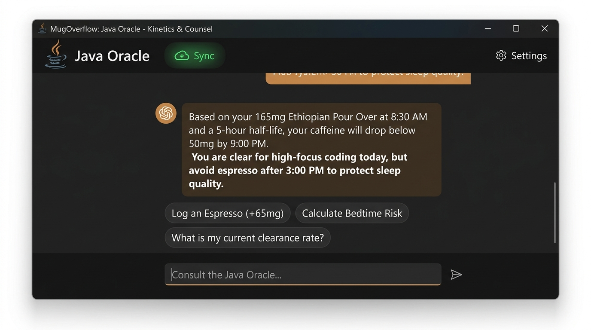
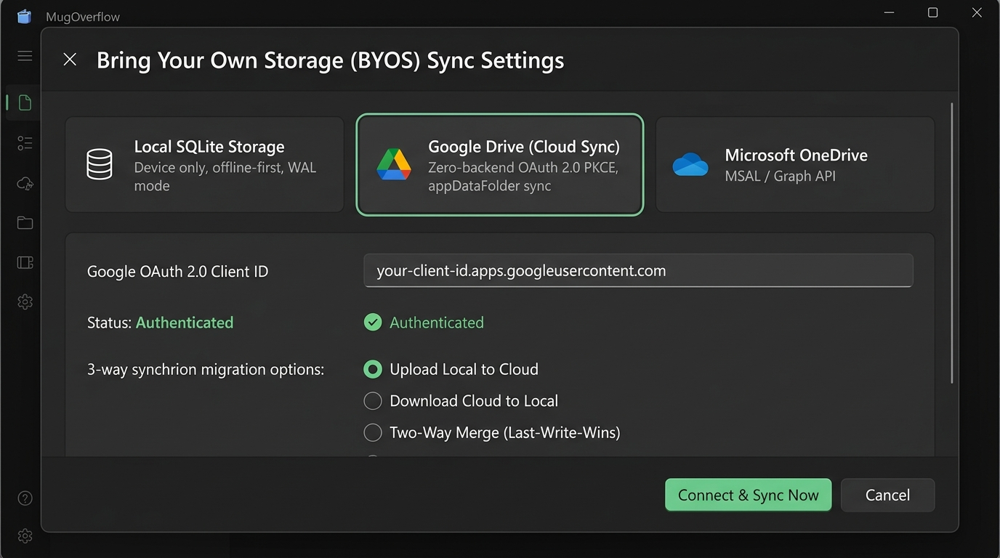
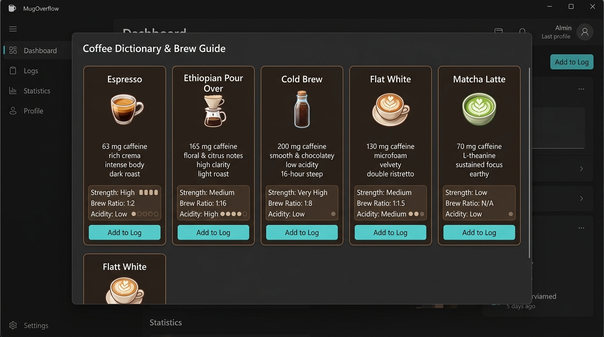

# MugOverflow ☕
### *Java Oracle & Real-Time Caffeine Kinetics Engine*

[](https://dotnet.microsoft.com/)
[](https://learn.microsoft.com/dotnet/maui/)
[](https://deepmind.google/technologies/gemini/)
[](https://sqlite.org/)
[](https://developers.google.com/drive)
[](tests/)

---

## 🤖 Built with AI Engineering (Google Gemini)

> **Fun Experimental Project Notice:**
> **MugOverflow was 100% designed, coded, and architected with Google Gemini.** 
> It was created as a fun, deep-dive project to explore the real-world capabilities of autonomous AI engineering, pair programming, and cross-platform native application development on **.NET 10**. From the zero-backend cloud synchronization engine down to the custom canvas-drawn metabolism curve, every line was generated and refined in collaboration with Gemini.

---

## 📸 Screenshots & How It Works

### 1. Kinetics Dashboard — Real-Time Metabolism Modeling
The dashboard calculates your dynamic blood caffeine concentration in milligrams using exponential decay modeling based on beverage timestamp, dosage, and customized half-life elimination rates.
- **Dynamic Canvas Rendering**: Smooth vector metabolism curve rendered in real-time via `Microsoft.Maui.Graphics.IDrawable`.
- **Bedtime & Sleep Risk**: Evaluates sleep disruption windows and warns when caffeine clearance exceeds bedtime thresholds.
- **Daily Intake Gauge**: Visual circular limit tracker (FDA recommended 400 mg/day baseline).



---

### 2. Java Oracle — Conversational Caffeine Intelligence
The **Java Oracle** provides conversational compliance counsel and intake optimization. Ask questions about intake timing, espresso extraction, or clearance rates, with quick suggestion chips for logging drinks or calculating bedtime risk.



---

### 3. Bring Your Own Storage (BYOS) & Cloud Synchronization
MugOverflow respects your privacy and data sovereignty. It features a zero-vendor-lockin **BYOS (Bring Your Own Storage)** architecture:
- **Local SQLite Persistence**: Low-latency, offline-first relational storage with Write-Ahead Logging (`PRAGMA journal_mode=WAL;`).
- **Google Drive Cloud Sync**: Zero-backend OAuth 2.0 PKCE synchronization saving directly to your isolated Google Drive `appDataFolder`.
- **Microsoft OneDrive Cloud Sync**: Enterprise-grade cloud synchronization using MSAL.NET and Microsoft Graph API (`special/approot`).
- **3-Way Data Migration**: Upload local to cloud, download cloud to local, or perform automatic two-way union hydration with Last-Write-Wins (LWW) conflict resolution.



---

### 4. Coffee Dictionary & Brew Guide
Browse standard caffeine dosages, extraction ratios, roast profiles, and acidity metrics for popular coffee styles (Espresso, Ethiopian Pour Over, Cold Brew, Flat White, Matcha Latte, and more) with one-tap logging into your kinetics engine.



---

## 🔐 Google Drive OAuth 2.0 Setup Guide

> **Important Developer Requirement:**
> MugOverflow connects directly from your device to Google Drive's REST API without intermediate relay servers. **If you want to run Google Drive synchronization, you must supply your own Google Cloud OAuth 2.0 Client ID** (just like we had to create for Google Drive authentication during development).

Follow these simple steps to configure your own Google OAuth 2.0 credentials:

### Step 1: Create a Google Cloud Project
1. Open the [Google Cloud Console](https://console.cloud.google.com/).
2. Click the project dropdown in the top bar and click **New Project**.
3. Name your project (e.g., `MugOverflow-Dev`) and click **Create**.

### Step 2: Enable the Google Drive API
1. Navigate to **APIs & Services > Library**.
2. Search for **Google Drive API**.
3. Select it and click **Enable**.

### Step 3: Configure the OAuth Consent Screen
1. Navigate to **APIs & Services > OAuth consent screen**.
2. Choose **External** user type and click **Create**.
3. Enter the required app information:
   - **App name**: `MugOverflow`
   - **User support email**: Your email address
   - **Developer contact information**: Your email address
4. Click **Save and Continue**.
5. Under **Scopes**, click **Add or Remove Scopes** and add:
   - `https://www.googleapis.com/auth/drive.appdata` *(Allows MugOverflow to read and write only its own application data folder)*
6. Under **Test users**, click **Add Users** and enter your Google account email address (this allows you to log in while your app is in testing mode).
7. Save and finish.

### Step 4: Create OAuth 2.0 Client Credentials
1. Navigate to **APIs & Services > Credentials**.
2. Click **Create Credentials > OAuth client ID**.
3. Configure credentials based on your platform:

#### For Windows Desktop:
- **Application type**: `Desktop app` (or `Web application`)
- **Name**: `MugOverflow Windows Desktop`
- If using Web application redirect:
  - **Authorized redirect URIs**: `mugoverflow://oauth2redirect` and `http://localhost:5000/oauth2redirect`
- Click **Create** and copy your **Client ID** and **Client Secret**.

#### For Android:
- **Application type**: `Android`
- **Name**: `MugOverflow Android`
- **Package name**: `com.companyname.mugoverflowproject`
- **SHA-1 certificate fingerprint**: Enter the SHA-1 of your debug keystore (`keytool -list -v -keystore ~/.android/debug.keystore`).

### Step 5: Provide Credentials to MugOverflow
You can configure your credentials in two convenient ways:

1. **Option A (Runtime UI - Recommended)**:
   - Launch MugOverflow.
   - Click the **Sync Pill** in the top navigation bar to open **BYOS Sync Settings**.
   - Select **Google Drive** and paste your Client ID and Client Secret into the custom credential fields.
   - MugOverflow stores them securely in platform encrypted storage (`ISecureStorageService`).

2. **Option B (Code Configuration)**:
   - Open `Services/Storage/GoogleDriveConfig.cs`.
   - Paste your Client ID and Secret into `WindowsClientId`, `WindowsClientSecret`, and `AndroidClientId`.

---

## 🏗️ Architecture & Technology Stack

| Component | Technology / Library | Details |
|---|---|---|
| **Framework** | .NET 10 / .NET MAUI | Multi-platform targeting Windows 10/11, Android, iOS, macOS Catalyst |
| **Language** | C# 13 / preview | Modern records, partial properties, pattern matching |
| **MVVM** | CommunityToolkit.Mvvm | Source-generated `[ObservableProperty]`, `[RelayCommand]` |
| **Local Database** | SQLite (`sqlite-net-pcl` & `SQLitePCLRaw.bundle_green`) | High-performance relational storage with Write-Ahead Logging (WAL) |
| **Cloud Sync** | Zero-Backend Google Drive & OneDrive | Google Drive v3 REST API (PKCE) & Microsoft Graph v1.0 (MSAL.NET) |
| **Kinetics Visualization** | `Microsoft.Maui.Graphics` (`IDrawable`) | Direct GPU canvas rendering with anti-aliasing and responsive clipping |
| **Icons & Design** | `FluentIcons.Maui` & Custom ResourceDictionaries | Runtime multi-theme engine (Coffee Dark, Coffee Light, Forest Lavender, Regal Earth, Wine Desert) |
| **Testing** | xUnit & Moq | 444 automated unit, integration, and adversarial stress tests |

---

## 🚀 Getting Started & Building

### Prerequisites
- [.NET 10 SDK](https://dotnet.microsoft.com/download/dotnet/10.0) (pinned via `global.json`)
- [.NET MAUI Workload](https://learn.microsoft.com/dotnet/maui/get-started/installation):
  ```bash
  dotnet workload install maui
  ```
- Visual Studio 2026 / Visual Studio Code with .NET MAUI extension (optional)

### Build & Run
Clone the repository:
```bash
git clone https://github.com/ejritter/MugOverflow.git
cd MugOverflow
```

Build the project:
```bash
dotnet build MugOverflowProject.csproj
```

Run on Windows:
```bash
dotnet run --project MugOverflowProject.csproj -f net10.0-windows10.0.19041.0
```

Run on Android (with emulator or device connected):
```bash
dotnet run --project MugOverflowProject.csproj -f net10.0-android
```

Run Test Suite:
```bash
dotnet test tests/MugOverflowProject.Tests/MugOverflowProject.Tests.csproj
```

---

## 🧪 Testing & Verification
MugOverflow is backed by **444 automated xUnit tests** covering:
- In-memory and disk-based SQLite transactional guarantees and WAL mode.
- Google Drive PKCE authorization URL generation, code verification, and token exchange.
- OneDrive MSAL authentication and approot payload serialization.
- Cold-start two-way hydration with Last-Write-Wins (LWW) conflict resolution.
- 5-minute background flush, network offline queueing, and lifecycle events (`OnSleep`/`Destroying`).
- Stress tests under high concurrency and adversarial payload conditions.

---

## 📄 License
This project is open-source under the [MIT License](LICENSE).
Feel free to fork, experiment, and brew your own extensions!
